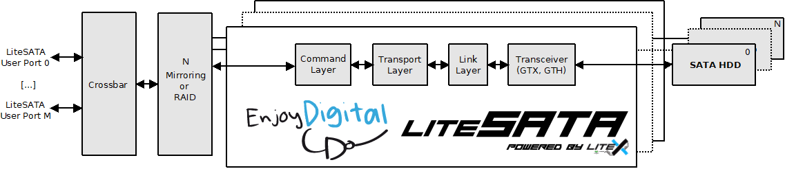

```
                                    __   _ __      _______ _________
                                   / /  (_) /____ / __/ _ /_  __/ _ |
                                  / /__/ / __/ -_)\ \/ __ |/ / / __ |
                                 /____/_/\__/\__/___/_/ |_/_/ /_/ |_|

                                  Copyright 2014-2026 / EnjoyDigital
                                     Copyright 2014-2015 / HKU

                              A small footprint and configurable SATA core
                                      powered by Migen & LiteX
```

[](https://github.com/enjoy-digital/litesata/actions)  [](https://deepwiki.com/enjoy-digital/litesata)


[> Intro
--------
LiteSATA provides a small footprint and configurable SATA core.

LiteSATA is part of LiteX libraries whose aims are to lower the entry level of
complex FPGA cores by providing simple, elegant and efficient implementations
of components used in today's SoC such as Ethernet, SATA, PCIe, SDRAM Controller...

Using Migen to describe the HDL allows the core to be highly and easily configurable.

LiteSATA can be used as LiteX library or can be integrated with your standard
design flow by generating the Verilog RTL that you will use as a standard core.

<p align="center"></p>

[> Features
-----------
PHY:
  - Xilinx Artix-7 GTP (`GTPE2_CHANNEL`)
  - Xilinx Kintex-7 GTX (`GTXE2_CHANNEL`)
  - Xilinx UltraScale GTH (`GTHE3_CHANNEL`)
  - Xilinx UltraScale+ GTH/GTY (`GTHE4_CHANNEL`/`GTYE4_CHANNEL`, selected with `gt_type`; Artix UltraScale+ is GTH only)
  - Lattice ECP5 SERDES (`DCUA`, Gen2 only, OOB generated/detected in fabric)
  - OOB, COMWAKE, COMINIT
  - ALIGN inserter/remover and bytes alignment on K28.5
  - 8B/10B encoding/decoding in transceiver
  - Automatic RX P/N polarity detection and swap, TX polarity alternated on each OOB attempt.
  - Error detection and reporting
  - 16/32-bit PHY datapath
  - 1.5/3.0/6.0Gbps supported speeds (respectively 37.5/75/150MHz system clock)

Core:

 - Link:
    - CONT remover (CONT is optional for a transmitter: the TX does not send it)
    - Scrambling/Descrambling of data
    - CRC inserter/checker
    - HOLD insertion/detection
    - Error detection and reporting
  - Transport/Command:
    - Easy to use user interfaces (Can be used with or without CPU)
    - 48 bits sector addressing
    - 3 supported commands: READ_DMA(_EXT), WRITE_DMA(_EXT), IDENTIFY_DEVICE
    - Error detection and reporting

Frontend:
  - Configurable crossbar (simply declare your crossbar and use crossbar.get_port() to add a new port!)
  - Standalone Verilog core generator (`litesata_gen`) with native user ports and/or a Wishbone/AXI-Lite control bus + Wishbone DMA master
  - Ports arbitration transparent to the user
  - Synthesizable BIST
  - Striping module to segment data on multiple HDDs and increase write/read speed and capacity. (RAID0 equivalent)
  - Mirroring module for data redundancy and increased read speed. (RAID1 equivalent)

[> FPGA Proven
--------------
LiteSATA is already used in commercial and open-source designs:
- High End 50Mpixels CMOS Camera using CFAST & SD cards.
- Low latency database research.

[> Possible improvements
------------------------
- add AXI-Stream user ports / AXI DMA master to the standalone core
- add host-side link rate negotiation (Gen3 -> Gen2 -> Gen1 fallback)
- add FLUSH CACHE / TRIM commands and 4Kn sector support
- add NCQ support
- add AES hardware encryption
- add on-the-fly compression/decompression
- add support for Altera/Intel PHYs.
- add ECP5 Gen1 (1.5Gbps) support and Linux integration.
- add Zynq Linux drivers.
- ... See below Support and consulting :)

If you want to support these features, please contact us at florent [AT]
enjoy-digital.fr.

[> Documentation
----------------
The **SATA Host Core & PHYs manual** is the reference of LiteSATA: a nightly
[PDF](https://github.com/enjoy-digital/litesata/releases/download/manual-nightly/litesata_manual.pdf)
and [HTML page](https://github.com/enjoy-digital/litesata/releases/download/manual-nightly/litesata_manual.html)
are published on the [manual-nightly](https://github.com/enjoy-digital/litesata/releases/tag/manual-nightly)
release. Sources in [doc/manual](doc/manual/README.md) (build: `python3 doc/manual/build.py`, outputs in
`build/doc/`; pandoc, XeLaTeX and the fonts listed in the README of `doc/manual`):

- **Understand**: [introduction](doc/manual/01_introduction.md), [SATA in a nutshell](doc/manual/02_sata_primer.md)
  (OOB, primitives, frames, FISes, ATA commands).
- **The core**: [architecture](doc/manual/03_core_architecture.md), [link layer](doc/manual/04_link_layer.md),
  [transport and command layers](doc/manual/05_transport_command.md), [frontends](doc/manual/06_frontends.md).
- **The PHYs**: [PHY architecture and OOB controller](doc/manual/07_phy_architecture.md),
  [Xilinx transceiver PHYs](doc/manual/08_xilinx_phys.md), [Lattice ECP5 PHY](doc/manual/09_ecp5_phy.md).
- **Use it**: [supported FPGAs and boards](doc/manual/10_boards.md), [getting started](doc/manual/11_getting_started.md),
  [integration](doc/manual/12_integration.md), [examples](doc/manual/13_examples.md), [simulation](doc/manual/14_simulation.md),
  [debugging](doc/manual/15_debugging.md).
- **Appendices**: [registers](doc/manual/A_registers.md), [build options](doc/manual/B_build_options.md),
  [glossary](doc/manual/C_glossary.md), [performance and resources](doc/manual/D_performance.md),
  [maintaining this manual](doc/manual/E_maintenance.md) (for contributors).

[> Getting started
------------------
1. Install Python 3.9+ and FPGA vendor's development tools.
2. Install LiteX and the cores by following the LiteX's wiki [installation guide](https://github.com/enjoy-digital/litex/wiki/Installation).
3. You can find examples of integration of the core with LiteX in LiteX-Boards and in the examples directory.

[> Standalone core generation
-----------------------------
A standalone Verilog core (native streaming ports, or a Wishbone/AXI-Lite control bus with DMA) can
be generated from a YAML description:
```sh
$ litesata_gen examples/artix7.yml
```
See the [Integration](doc/manual/12_integration.md) chapter of the manual for the flavours and
the ports, and [Build options](doc/manual/B_build_options.md) for the YAML keys.

[> Tests
--------
Unit tests are available in ./test/.
To run all the unit tests:
```sh
$ python3 -m pytest -v
```

Tests can also be run individually:
```sh
$ python3 -m pytest -v test/test_name.py
```

[> License
----------
LiteSATA is released under the very permissive two-clause BSD license. Under the
terms of this license, you are authorized to use LiteSATA for closed-source
proprietary designs.
Even though we do not require you to do so, those things are awesome, so please
do them if possible:
 - tell us that you are using LiteSATA
 - cite LiteSATA in publications related to research it has helped
 - send us feedback and suggestions for improvements
 - send us bug reports when something goes wrong
 - send us the modifications and improvements you have done to LiteSATA.

[> Support and consulting
-------------------------
We love open-source hardware and like sharing our designs with others.

LiteSATA is developed and maintained by EnjoyDigital.

If you would like to know more about LiteSATA or if you are already a happy
user and would like to extend it for your needs, EnjoyDigital can provide standard
commercial support as well as consulting services.

So feel free to contact us, we'd love to work with you! (and eventually shorten
the list of the possible improvements :)

[> Contact
----------
E-mail: florent [AT] enjoy-digital.fr
